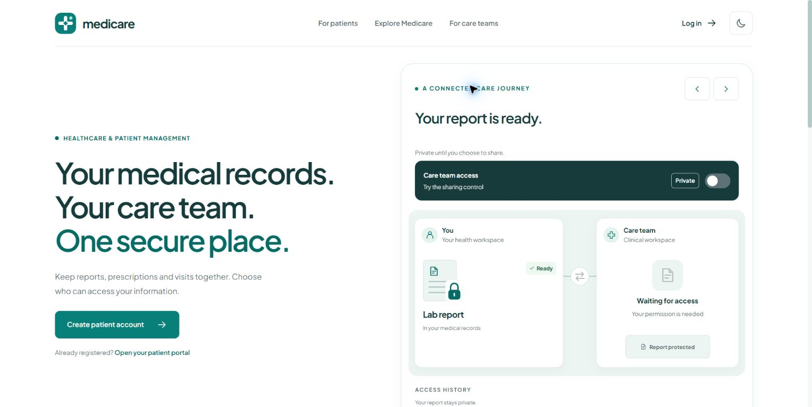
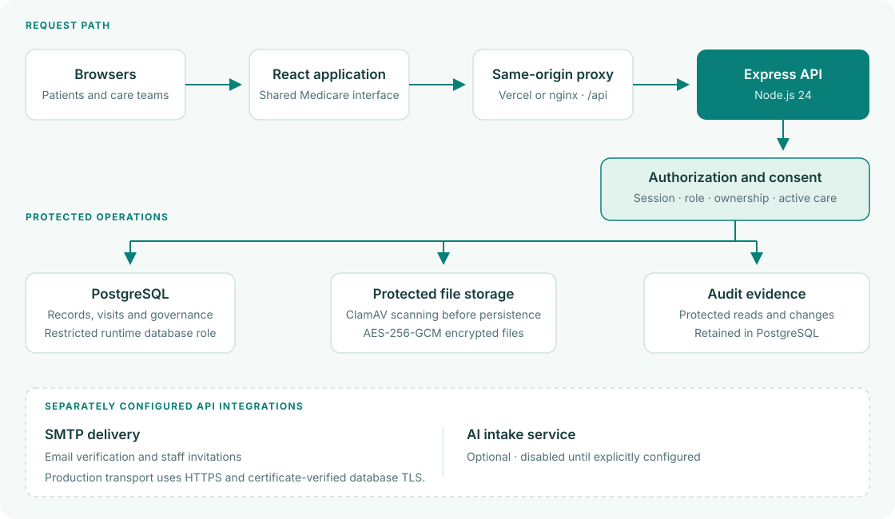

<div align="center">
  
  <h1>Medicare</h1>
  <p><strong>Secure healthcare information and patient management.</strong></p>
  <p>Medical records, connected care, and patient-controlled sharing in one place.</p>
  <p>
    <a href="https://medicare-vtg.vercel.app/">Live Website</a> ·
    <a href="#getting-started">Getting Started</a> ·
    <a href="#architecture">Architecture</a> ·
    <a href="#documentation">Documentation</a>
  </p>
</div>



## Overview

Medicare connects patients and healthcare teams through a shared, permission-aware care platform. Patients can review their medical history, manage visits, and choose who can access their information. Clinical teams work with records, prescriptions, diagnostic orders, and care correspondence within their assigned roles and care relationships.

The project implements the **Secure Healthcare Information & Patient Management System with Regulatory Compliance** problem statement. Its focus extends beyond appointment booking to confidentiality, consent, traceability, patient rights, and accountable information use.

## Contents

- [Capabilities](#capabilities)
- [User roles](#user-roles)
- [Technology stack](#technology-stack)
- [Architecture](#architecture)
- [Getting started](#getting-started)
- [Configuration](#configuration)
- [Development and verification](#development-and-verification)
- [Deployment](#deployment)
- [Repository structure](#repository-structure)
- [Documentation](#documentation)
- [Contributing](#contributing)
- [Security reporting](#security-reporting)
- [Contributors](#contributors)
- [License](#license)

## Capabilities

| Area | What Medicare provides |
| --- | --- |
| Patient records | Medical history, clinical notes, diagnoses, prescriptions, laboratory results, and imaging reports. |
| Visits and appointments | Published provider calendars, clinic time zones, availability based on actual reservations, check-in, staff assignment, and visit lifecycle management. |
| Consent and sharing | Patient-managed grants with recipient, category, purpose, permission level, and expiry; withdrawal blocks future access. |
| Care coordination | Role-specific workspaces, clinical order queues, medication workflows, and encrypted patient–provider correspondence. |
| Identity and access | Password and passkey authentication, revocable sessions, staff invitations, administrator review, and organization-scoped authorization. |
| Audit and oversight | Retained access and change evidence, serialized audit hash chains, incident casework, breach assessments, and internal responder notifications. |
| Emergency access | Patient-specific, time-limited, read-only access with audit evidence, an incident record, and patient notification. |
| Patient rights | Subject exports, correction requests, processing restrictions and objections, attributed clinical addenda, and decision histories. |
| Retention governance | Versioned retention policies, legal holds, reviewed disposal approvals, and separate owner-operated disposal tooling. |
| Research | Consent-scoped aggregate analysis with small-cohort suppression and no row-level research export. |

AI-assisted intake is an optional integration. It requires a separately configured service and explicit enablement; clinical review remains necessary.

## User roles

| Users | Primary workflows |
| --- | --- |
| Patients | Review records, manage visits and consent, exchange care messages, and submit privacy requests. |
| Physicians and nurses | Review authorized records, document care, manage diagnoses and prescriptions, and coordinate treatment. |
| Laboratory technicians and radiologists | Process assigned diagnostic orders and submit results or reports. |
| Pharmacists | Review authorized prescriptions, process medication queues, and manage inventory. |
| Receptionists | Register patients, coordinate visits, and manage check-in workflows. |
| Hospital and system administrators | Review registrations, manage staff and organizations, and oversee operations within their scope. |
| Compliance officers | Review audit evidence, incidents, privacy casework, retention policies, and legal holds. |
| Insurance officers and researchers | Access purpose-limited insurance workflows or approved aggregate research, respectively. |

Role membership alone does not grant unrestricted record access. Server-side checks also consider ownership, organization, active care assignments, and applicable consent.

## Technology stack

| Layer | Technology |
| --- | --- |
| Web application | React 19, React Router, Vite 8, Tailwind CSS, and shared Medicare theme tokens. |
| API | Node.js 24, Express 4, and PostgreSQL via `pg`. |
| Optional AI service | Python, FastAPI, Groq integration, and separately enabled retrieval. |
| Authentication | bcrypt, JWT access and refresh tokens, database-backed sessions, and WebAuthn passkeys. |
| Protected data | AES-256-GCM application encryption and ClamAV upload scanning. |
| Verification | Vitest, React Testing Library, Supertest, Node.js test runner, and ESLint. |
| Operations | Docker Compose, nginx, GitHub Actions, Prometheus, and Grafana. |
| Hosted application | Vercel frontend, Render API, and Supabase PostgreSQL. |

## Architecture



[Diagram source and icon credits](docs/design/architecture-diagram.md).

The API enforces authorization at the data boundary. Database migrations run separately from the restricted runtime account. In the hosted configuration, application tables live in a private `healthcare` schema and the public database Data API is disabled.

Medical files and care messages use authenticated application encryption. Production database connections require certificate-verified TLS. Uploads require successful malware scanning before encrypted persistence; scanner failure blocks the upload. Database and audit controls retain evidence of protected operations.

These safeguards support compliance-aware engineering grounded in GDPR and HIPAA principles. They do not constitute regulatory certification. Use with actual patient information also requires appropriate provider arrangements, verified storage encryption, access governance, incident procedures, and tested recovery. See the [architecture and threat model](docs/architecture-threat-model.md) for guarantees and boundaries.

## Getting started

### Prerequisites

- **Node.js 24.x** and npm; both application packages require `>=24 <25`.
- **PostgreSQL 18** for parity with the production Compose template and CI, with an empty local database and a migration-capable owner account.
- **Git** and access to this repository.
- An SMTP service for email verification and invitations. ClamAV is required for document upload workflows. Neither integration is necessary just to start the API and frontend.

Docker Compose 2.20 or later can supply the local dependencies. After cloning, Windows users can run `./scripts/dev-bootstrap.ps1` in PowerShell to install locked Node dependencies, generate missing local secrets, validate configuration, and start PostgreSQL, Mailpit, ClamAV, the API and frontend. Existing environment files and database volumes are preserved. Continue with administrator setup once the stack is ready; follow the numbered configuration steps below for native development. See [DEVOPS.md](DEVOPS.md) for both approaches.

### 1. Clone and install

```sh
git clone https://github.com/vTg2208/medicare-secure.git
cd medicare-secure
npm ci --prefix backend
npm ci --prefix frontend
```

### 2. Configure the environment

Copy `backend/.env.example` to `backend/.env` and `frontend/.env.example` to `frontend/.env` using your editor or file manager. Enter the local database connection details and unique values for `JWT_SECRET`, `JWT_REFRESH_SECRET`, and `ENCRYPTION_KEY`.

The backend template uses `127.0.0.1:55432`, database `healthcare`, and owner `healthcare_owner`. Provision these locally or change the settings to match your PostgreSQL instance. Local development may use `DB_SSL=false`; production requires verified TLS.

Generate each secret independently with:

```sh
node -e "console.log(require('node:crypto').randomBytes(32).toString('hex'))"
```

Keep these values in your local environment files. The two JWT secrets must differ; the encryption key must contain exactly 64 hexadecimal characters. Configure SMTP and ClamAV when exercising their workflows.

### 3. Apply migrations and start the API

Run these commands from `backend` so the application loads its environment file:

```sh
cd backend
npm run db:migrate
npm run dev
```

Migrations are ordered and checksum-tracked. Startup checks that the schema matches the migration chain; previously applied migration files must not be edited.

### 4. Start the frontend

In a second terminal, from the repository root:

```sh
cd frontend
npm start
```

| Local endpoint | Purpose |
| --- | --- |
| `http://localhost:3000` | Web application. |
| `http://localhost:5000/health` | API liveness. |
| `http://localhost:5000/readyz` | Database connectivity and schema readiness. |

Vite proxies `/api` and `/readyz` to `http://localhost:5000`. Set `API_PROXY_TARGET` in the frontend process environment if your API runs elsewhere.

### 5. Create the first administrator

For a fresh database, set `ADMIN_EMAIL` and `ADMIN_PASSWORD` in `backend/.env`, then run `npm run db:bootstrap-admin` from `backend`. The password must be at least 12 characters and no more than 72 UTF-8 bytes. Remove the temporary bootstrap values afterward.

The bootstrap defaults to `system_admin`, refuses to overwrite existing credentials, and does not create another system administrator if one already exists. Patients use registration and email verification; subsequent staff onboarding uses the authenticated invitation and review workflows.

## Configuration

The complete local templates are [backend/.env.example](backend/.env.example) and [frontend/.env.example](frontend/.env.example).

| Settings | Purpose |
| --- | --- |
| `DB_HOST`, `DB_PORT`, `DB_NAME`, `DB_USER`, `DB_PASSWORD` | PostgreSQL connection and database role. |
| `DB_SSL`, `DB_SSL_CA_FILE` or `DB_SSL_CA` | Database TLS and trusted certificate configuration. |
| `JWT_SECRET`, `JWT_REFRESH_SECRET`, `ENCRYPTION_KEY` | Independent signing secrets and application encryption key. |
| `FRONTEND_URL`, `CORS_ORIGIN`, `WEBAUTHN_ORIGIN`, `WEBAUTHN_RP_ID` | Allowed application origins and passkey relying-party identity. |
| `EMAIL_HOST`, `EMAIL_PORT`, `EMAIL_SECURE`, `EMAIL_FROM`, `EMAIL_USER`, `EMAIL_PASSWORD` | SMTP delivery; configure credentials if required by the relay. |
| `CLAMAV_HOST`, `UPLOAD_PATH`, `MAX_FILE_SIZE_MB` | Scanning, protected file storage, and upload size limit. |
| `AI_ENABLED`, `AI_SERVICE_URL`, `AI_SERVICE_TOKEN` | Optional AI integration, disabled by default. |
| `METRICS_TOKEN`, `BACKUP_ENCRYPTION_KEY` | Protected production metrics and a separate backup encryption key. |
| `REACT_APP_API_URL`, `REACT_APP_API_TIMEOUT_MS` | Browser API path and request timeout; default to `/api` and 15 seconds. |

Frontend configuration is embedded at build time and must contain no secrets. Environment files, uploaded documents, private credentials, and runtime logs are excluded from source control.

## Development and verification

Run backend checks from `backend`:

```sh
npm run check
npm test
```

Run frontend checks from `frontend`:

```sh
npm run lint -- --max-warnings=0
npm test
npm run build
```

The frontend build includes the shared-theme check. GitHub Actions also runs dependency audits and production container checks; the backend workflow provisions PostgreSQL for database verification.

The optional AI service has its own [setup and offline test guide](ai-service/README.md). Its CI runs on Python 3.11 and 3.12, blocks external provider calls in tests, and builds the minimal service image.

Integration tests use `npm run test:integration` from `backend`. They require an explicitly selected, migrated, disposable loopback PostgreSQL database on port `55432`, a database name containing `test`, a role allowed to create test databases, `NODE_ENV=test`, `RUN_DB_TESTS=true`, and `RUN_BROWSER_DB_TESTS=true`. Recovery cases also require matching `pg_dump` and `pg_restore` tools. See the [backend CI workflow](.github/workflows/backend-ci.yml) for the complete environment; never target a hosted or working application database.

## Deployment

| Component | Current hosting configuration |
| --- | --- |
| Frontend | **Vercel Hobby** · root `frontend` · install `npm ci` · build defined in `frontend/vercel.json` · output `build`. |
| API | **Render Free** · root `backend` · build `npm ci --omit=dev` · start `npm start` · readiness `/readyz`. |
| Database | **Supabase PostgreSQL** · private application schema · restricted API role · public Data API disabled. |

The [Vercel configuration](frontend/vercel.json) supplies the same-origin API proxy, security headers, and a 90-second client timeout for backend cold starts. Free services may sleep or reach quotas. Email, uploads, and AI depend on their configured delivery, scanning, storage, and service integrations.

For self-managed infrastructure, [docker-compose.prod.yaml](docker-compose.prod.yaml) separates migration and runtime credentials, mounts database TLS material, and exposes nginx on loopback for an external HTTPS proxy. Apply database upgrades before releasing dependent API changes. Follow the operational runbooks for durable storage, encrypted backups, restore verification, and monitoring.

## Repository structure

```text
.
├── frontend/                    # React application, shared theme, and UI tests
├── ai-service/                  # Optional FastAPI intake service and offline tests
├── backend/
│   ├── src/modules/             # Clinical, identity, consent, and governance APIs
│   ├── src/database/ordered/    # Checksum-tracked SQL migrations
│   ├── scripts/                # Provisioning, backup, and operator tools
│   └── tests/                  # Unit, HTTP, database, and recovery tests
├── deployment/                  # Infrastructure entrypoints and TLS support
├── scripts/                     # Local setup, validation, and migration helpers
├── monitoring/                  # Monitoring and alert configuration
├── docs/                        # Architecture, requirements, and operations
├── legacy/                      # Historical reference material, outside runtime builds
├── .github/workflows/           # Backend and frontend CI
├── docker-compose.prod.yaml     # Self-managed production services
└── STYLEGUIDE.md                 # Shared Medicare design system
```

## Documentation

| Guide | Use it for |
| --- | --- |
| [Problem statement](docs/problem-statement.md) | Project objectives and required scope. |
| [Operations runbook](DEVOPS.md) | Local Docker setup, environment validation, and service operations. |
| [AI service guide](ai-service/README.md) | Optional provider setup, retrieval, and offline verification. |
| [Repository preservation](docs/repository-preservation.md) | Recreating the checkout and keeping private recovery material separate. |
| [Requirement coverage](docs/requirements-traceability.md) | Implementation evidence, optional scope, and operational obligations. |
| [Architecture and threat model](docs/architecture-threat-model.md) | Trust boundaries, authorization, and tested threat responses. |
| [Audit integrity](docs/clinical-audit-integrity.md) | Clinical evidence, append-only history, and integrity guarantees. |
| [Appointment calendars](docs/appointment-calendars.md) | Availability, time zones, and reservation rules. |
| [Privacy fulfillment](docs/privacy-fulfillment.md) | Corrections, restrictions, objections, and subject exports. |
| [Retention and disposal](docs/retention-disposal.md) | Policy review, legal holds, and controlled disposal. |
| [Database transport](docs/database-transport.md) | Verified TLS and responder delivery boundaries. |
| [Backup and recovery](docs/backup-recovery.md) | Coordinated encrypted backups and restore drills. |
| [Monitoring readiness](docs/monitoring-readiness.md) | Metrics, alert configuration, and delivery verification. |
| [File encryption migration](docs/file-encryption-migration.md) | Explicit upgrades of existing encrypted file storage. |
| [Style guide](STYLEGUIDE.md) | Brand, typography, colors, accessibility, and shared components. |
| [Release evidence](docs/releases/2026-11-01-mandatory-live-release.md) | Recorded deployment and workflow verification. |

## Contributing

Use a focused branch and describe the problem, resulting behavior, and verification in each pull request. Keep changes in separate, meaningful commits. Update relevant documentation when setup, configuration, permissions, or workflows change.

Run the checks for each affected service. Authorization, consent, and data-handling changes should include regression coverage for both permitted and denied operations. Add new migrations rather than changing previously applied SQL, and follow [STYLEGUIDE.md](STYLEGUIDE.md) for interface changes.

## Security reporting

Report suspected vulnerabilities privately to the repository maintainers. Do not include credentials, patient information, or sensitive exploit details in public issues or pull requests.

## Contributors

Chirag Keshav · Devansh Dewan · Harish G M · Harshita R · Sarvanthikha SR · Theegela Vishnu Vardhan

Amrita Vishwa Vidyapeetham.

## License

The backend package declares ISC. A repository-wide `LICENSE` file is not currently included.
