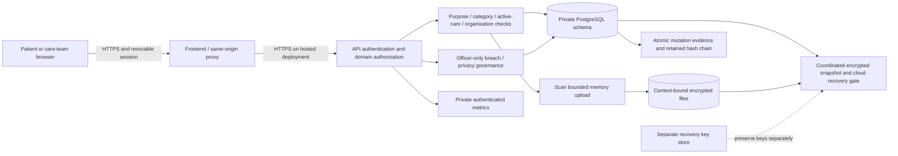

# Architecture and threat model

## Boundaries

The React application authenticates through a same-origin API proxy. Express verifies a revocable session and uses role, ownership, organization, active-care assignment and scoped/purpose-bound consent before clinical operations. The application database principal can operate data but cannot administer schemas, edit migration history or mutate retained audit entries. Migrations run separately under a migration principal. The hosted database schema is private and its public Data API is disabled.

Application envelopes protect reports, credentials, governance narratives and backup artifacts. They do not independently prove encryption of ordinary clinical database columns or the host volume. HTTPS/TLS termination, database certificate verification, storage encryption and provider agreements are deployment responsibilities with explicit readiness conditions.

## Threats and tested responses

| Threat | Engineering response | Evidence / limit |
| --- | --- | --- |
| Anonymous or wrong-role access | Session authentication and role checks before domain operations. | Unit/API role-denial tests. A compromised endpoint or database-owner account is outside this authorization guarantee. |
| Curious insider, wrong hospital or unrelated visit | Object/list scope plus organization/assignment/active care and category/level/time/purpose consent. | Actual cross-patient/tenant/research-purpose/insurance-purpose regressions. |
| Consent withdrawn or partially edited | Current database consent evaluated per operation; no broad cache; independent grants and validated partial edits. | Revocation, expiry and separate-scope tests. Data already legitimately received cannot be remotely recalled by consent revocation. |
| Cancelled order replay or concurrent dispensing | Locked state transitions and result/order ownership checks; terminal states reject replay. | Actual concurrent HTTP/database tests; client-only hiding is not the enforcement mechanism. |
| Patient switched while a form request is pending | Visit identity guards prevent delayed note/Rx/Dx results attaching to another selected visit. | Rendered clinical-page behavior tests. |
| Malware, scanner outage or plaintext upload remnants | Bounded memory intake; fail closed before encrypted persistence; protected authenticated downloads. | Upload/reliability tests; production scanner signature freshness still needs operations. |
| Stored ciphertext tamper or patient/file substitution | AES-GCM authentication includes canonical relative file identity. | Tamper, wrong-key, cross-context and legacy downgrade tests. Key compromise remains a key-management incident. |
| Audit unavailable, process failure or response race | Protected response waits for durable evidence; clinical/consent/emergency changes have same-transaction database evidence. | Injected audit failure aborts mutations; immutable governance histories. Client receipt cannot be guaranteed after a network disconnect. |
| Concurrent audit writers or stale export snapshots | Serialized hash-chain head row and repeatable-read serialization rejection/retry. | Actual concurrency/hash integrity tests. Database-owner tampering or destruction requires external backup/monitoring evidence. |
| Temporary relation/function shadowing | Schema-qualified audit state/functions and locked clinical-trigger search path. | Actual shadow-table regression; API principal has no schema DDL privilege. |
| Research re-identification | Explicit research consent, no row-level/identity output, suppressed small distinct-patient aggregates. | Cohort threshold/revocation tests. No differential privacy or formal anonymity proof; differencing and auxiliary-data risks remain subject to study governance. |
| Backup loss, tamper or unsafe restoration | Independent backup key, one coordinated exported snapshot, authenticated manifest/checksums, strict paths and fresh disposable restore targets. | Actual live B2 downloads, database/file recovery, application decryption and same-day rotation passed; the daily schedule is enabled. Recovery objectives, promotion/failover acceptance and operator alert delivery remain external requirements. |
| Log or telemetry growth | Finite file rotation, no clinical payloads in request audit, bounded monitoring retention and real failure metrics. | Log transport test and Prometheus rule validation. Alert receiver and actual delivery require explicit deployment configuration. |

The API is designed to demonstrate compliance-aware controls. It does not make a medical decision, determine legal applicability automatically or certify the hosting environment.

The checked [control matrix](compliance/control-evidence.md), exact [catalog inventory](compliance/data-inventory.json), [data lifecycle](compliance/data-lifecycle.md) and [external-assurance checklist](compliance/operational-assurance.md) separate current implementation from historical test results and provider/owner responsibilities. Render's logical upload root is not a persistent disk: current durable ciphertext is held in the private PostgreSQL object table. The remote worker reads those objects in the same snapshot as their database references.
