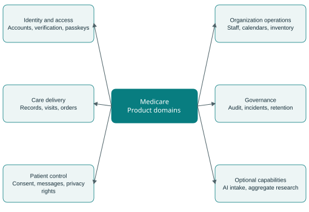
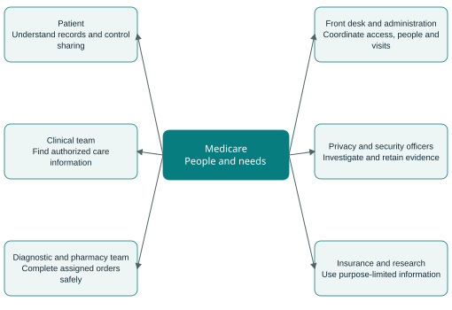
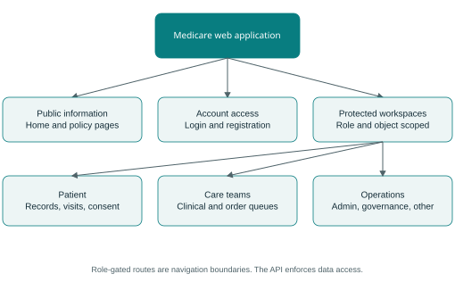
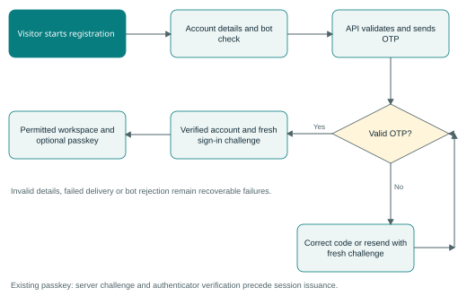
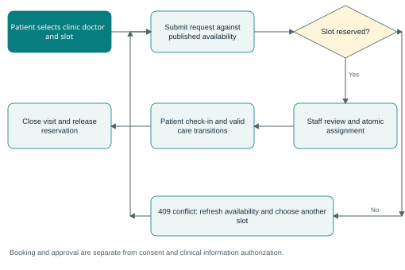
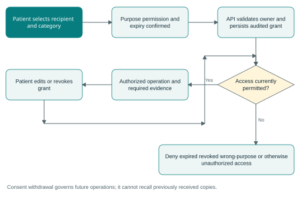
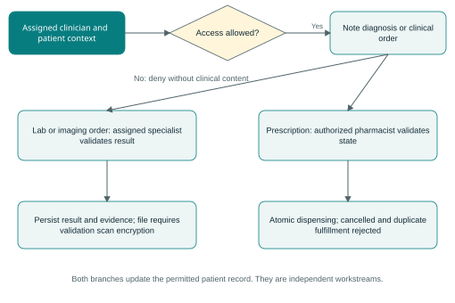
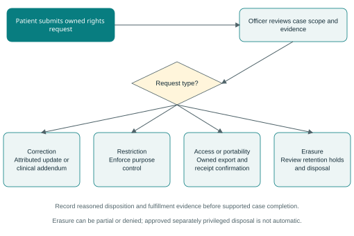
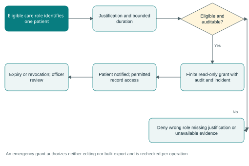

# Medicare information architecture

MC-IA-001 | Version 1.0 | 16 November 2026

Status: For stakeholder review and baseline approval

## Contents

1. Information architecture scope
2. Contents
3. Product domain mindmap
4. Audience and access mindmap
5. Application sitemap
6. Public and patient route inventory
7. Clinical and specialist route inventory
8. Operations governance and shared routes
9. Account onboarding and authentication flow
10. Appointment and visit flow
11. Consent grant and withdrawal flow
12. Clinical records diagnostics and medication flow
13. Patient rights fulfillment flow
14. Emergency access and oversight flow
15. Interaction accessibility and validation
16. References and baseline control

## Information architecture scope

This document defines how Medicare information is grouped, labeled and reached, and how users move through priority tasks. It connects the product requirements to the current route structure and establishes a reviewable navigation and interaction contract.

| Document control | Value |
| --- | --- |
| Document ID | MC-IA-001 |
| Version and date | 1.0 / 16 November 2026 |
| Review state | For product design and engineering review |
| Owner | Product design role; individual appointment pending |
| Dependencies | MC-PRD-001 and MC-TRD-001 |

### Organizing model

Public content explains the service and provides account entry. Authenticated workspaces group tasks by role. Patient and visit context govern clinical work; organization and purpose govern operational access. Shared concepts such as records, visits and consent retain consistent names across role-specific screens.

### Architecture rules

- Do not merge administrative authority with clinical entitlement. A navigation link never grants data access.
- Use task-based groups: records, visits, sharing, messages and privacy for patients; assigned work and queues for care teams.
- Use server-provided status, counts and availability. Show unavailable or unconfigured states when a dependency or real value is absent.
- Preserve the current theme, route compatibility and password/passkey alternatives. New navigation proposals require explicit acceptance before implementation.

### Diagram notation

The mindmaps are conceptual groupings. The sitemap is a hierarchy, not an exact menu specification. Rounded boxes show tasks; diamonds show decisions. Flow arrows show progress and labeled exceptions. API authorization, persistence and evidence gates remain mandatory even when omitted from a screen label.

The route inventory is extracted from committed AppRoutes.jsx and supplied as CSV. Exact frontend role gates are recorded there; server domain authorization is specified separately. No card-sort or usability study is claimed.

## Contents

Use these sections for review and maintenance. PDF bookmarks provide the same section navigation. Requirement IDs and flow IDs remain stable when page numbers change.

| Section | Page |
| --- | --- |
| Information architecture scope | 1 |
| Product domain mindmap | 3 |
| Audience and access mindmap | 4 |
| Application sitemap | 5 |
| Public and patient route inventory | 6 |
| Clinical and specialist route inventory | 7 |
| Operations governance and shared routes | 8 |
| Account onboarding and authentication flow | 9 |
| Appointment and visit flow | 10 |
| Consent grant and withdrawal flow | 11 |
| Clinical records diagnostics and medication flow | 12 |
| Patient rights fulfillment flow | 13 |
| Emergency access and oversight flow | 14 |
| Interaction accessibility and validation | 15 |
| References and baseline control | 16 |

## Product domain mindmap

Editable source: [Mermaid](../diagrams/01-product-mindmap.mmd)

### Grouping rationale

Patient control is a first-class domain alongside clinical care. Governance supports every domain rather than appearing only under system settings. Organization operations are separate from clinical records so administrative tasks do not imply broad record visibility.

### Content relationships

A patient can have visits and records. A visit can carry notes, prescriptions and diagnostic orders. Consent constrains allowed uses of information; booking and consent remain distinct. Audit and case histories retain evidence of operations without replacing the underlying clinical record.

## Audience and access mindmap

Editable source: [Mermaid](../diagrams/02-audience-mindmap.mmd)

### Role adaptation

Shared concepts may appear in several workspaces, but lists and actions must be scoped to the current role and organization. A physician sees assigned care information, a pharmacist sees permitted prescription work, and a researcher sees approved aggregates. Patient-facing language should explain an action and its consequences.

### Validation plan

Review the grouping with representatives of patient, physician, nursing, front-desk, specialist and compliance roles. Run a tree test to locate a record, change sharing, find a visit, complete a queued order and review a privacy request. Record misroutes before proposing menu changes.

## Application sitemap

Editable source: [Mermaid](../diagrams/03-sitemap.mmd)

### Cross-cutting destinations

Profile, help, session exit and applicable policy links are shared support destinations. Clinical patient detail is contextual, not a globally browsable directory for every user. The optional AI intake belongs in the patient workspace and its clinician-review counterpart; neither becomes an emergency pathway.

### Fallbacks

The current wildcard route redirects to home. The lab alias /lab/dashboard redirects to /dashboard/lab. The explicit /unauthorized screen handles denied navigation. Authenticated API failures must still show an appropriate in-context state rather than converting denial into empty clinical data.

## Public and patient route inventory

| Group | Current routes | Access and purpose |
| --- | --- | --- |
| Public information | / / /about / /support / /accessibility / /terms / /cookies | Anonymous information and policy access. |
| Notices | /privacy-notice/:versionId? | Current or versioned public privacy notice. |
| Account entry | /login / /register / /staff/invitation/:token | Public entry; invitation requires a valid scoped token. /register?verify=1 selects email verification mode. |
| Patient home and records | /patient/dashboard / /patient/medical-records / /patient/medical-records-view | Patient account; owned records. |
| Visits | /patient/visits / /patient/visits/new / /patient/visits/schedule / /patient/visits/verify-otp | Patient request, scheduling, status and check-in-related tasks. |
| Sharing and evidence | /patient/consent / /patient/consent/grant / /patient/audit-trail | Patient sharing decisions and permitted access evidence. |
| Communication and privacy | /patient/messages / /patient/support / /patient/privacy | Patient correspondence and rights casework. |
| Optional intake | /patient/chatbot | Patient route; actual AI requires explicit integration enablement. |

### Terminology contract

Records means clinical information. Visits means care encounters and appointment requests. Sharing means scoped consent. Privacy requests means formal rights casework; it is distinct from revoking a sharing grant. Check-in does not imply that clinical consent has been granted.

Route availability is implementation evidence, not proof that every external integration or screen has received fresh stakeholder acceptance. The full CSV includes role strings and shared routes.

## Clinical and specialist route inventory

| Workspace | Current destinations | Boundary |
| --- | --- | --- |
| Doctor | /doctor/dashboard / /doctor/active-visits / /doctor/patients / /doctor/patients/:id/records / /doctor/consent / /doctor/notes / /doctor/messages / /doctor/triage-sessions | Doctor role plus care, organization, consent and purpose checks. |
| Nurse | /nurse/dashboard / /nurse/patients / /nurse/patients/:id/records / /nurse/medications / /nurse/vitals / /nurse/schedule / /nurse/messages / /nurse/profile | Nurse role and assigned-care scope. |
| Laboratory | /dashboard/lab / /lab/dashboard redirect | lab_tech or lab_technician frontend role aliases; assigned order authorization. |
| Radiology | /radiology/dashboard / /radiology/queue / /radiology/upload / /radiology/profile / /radiology/audit-logs | Radiologist role; permitted imaging orders, reports and evidence. |
| Pharmacy | /pharmacist/dashboard / /pharmacist/prescriptions / /pharmacist/inventory / /pharmacist/profile / /pharmacist/audit-logs | Pharmacist role; valid prescription state and organizational scope. |

### Patient context contract

Display patient identity and current visit context near documentation and order actions. Changing patients clears or reconciles stale form state. An asynchronous result can update only the identity for which it was requested. Confirmations state the patient, action and outcome.

### Queue structure

Queues distinguish pending, actionable and terminal work using text as well as color. Sort and filtering must correspond to real server data. AI confidence is not clinical urgency. Disabled or unavailable actions explain the prerequisite needed to proceed.

## Operations governance and shared routes

| Workspace | Current route families and key destinations | Boundary |
| --- | --- | --- |
| Administration | /admin/dashboard / /admin/visits / /admin/staff / /admin/users / /admin/audit-logs / /admin/doctor-registration / /admin/doctor-verification / /admin/appointment-calendars | Per-route admin, hospital_admin or system_admin gates; calendar route allows hospital_admin and system_admin. Organization checks still apply. |
| Reception and staff | /receptionist/visits / /staff/dashboard / /staff/workflow / /staff/registration / /staff/visit-queue | Explicit route-specific role gates. Registration allows receptionist, nurse or staff; visit-queue allows staff. |
| Compliance | /compliance/dashboard / /compliance/global-audits / /compliance/incidents / /compliance/consent-overrides / /compliance/privacy / /compliance/retention / /compliance/notices / /compliance/profile | compliance_officer; governed case and publication authority. |
| Insurance | /insurance/dashboard / /insurance/claims / /insurance/coverage / /insurance/policyholders / /insurance/profile | insurance or insurance_provider aliases plus purpose and data scope. |
| Research | /researcher/dashboard / /researcher/explorer / /researcher/profile | researcher; consented aggregate output. |
| Shared | /messages / /profile / /patient/profile / /unauthorized | Role gates differ by route. Exact role strings are preserved in route-inventory.csv. |

### Navigation versus security

Hidden admin links reduce confusion, but protected routing and server-side authorization enforce access. Avoid revealing officer narratives, unrelated patient names or tenant inventory through counts, suggestions or error text.

## Account onboarding and authentication flow

Editable source: [Mermaid](../diagrams/04-onboarding-flow.mmd)

### Entry and completion

Entry is the public registration or sign-in page, or a scoped staff invitation. Successful completion is an issued and verified session routed to the permitted workspace. A pending registration is not a successful login. Optional passkey enrollment requires an authenticated account.

### Recovery and interaction requirements

Preserve valid form input when a correctable error occurs. Distinguish code validation, code resend and sign-in as separate operations. Replace consumed bot tokens before another protected action. A new widget must be ready before enabling an action that needs its token. Passkey cancellation returns to a usable sign-in screen.

Traceability: FR-01, FR-02, FR-03; auth and passkey route modules; registration UI tests. Browser device enrollment and real email delivery require intended-environment acceptance.

## Appointment and visit flow

Editable source: [Mermaid](../diagrams/05-appointment-flow.mmd)

### Entry and completion

Entry is the patient visit workspace with a selected clinic and provider. A successful booking persists the server-validated slot. Staff approval, assignment and patient check-in are later transitions. Calendar edits cannot silently discard existing reservations.

### Boundary and exception requirements

Display the clinic time zone when choosing time. On conflict, preserve the selected clinic and provider and refresh available slots. Do not imply that clicking a calendar cell reserves it. Unavailable calendars, service failures and empty results have distinct states. Consent is evaluated independently when care information is accessed.

Traceability: FR-06, FR-07; appointment routes and reservation exclusion tests. The visual is a task overview; exact visit state transitions remain defined by the domain service.

## Consent grant and withdrawal flow

Editable source: [Mermaid](../diagrams/06-consent-flow.mmd)

### Decision content

Before confirmation, show who receives access, which information categories, the purpose, permission level and expiry. Use clear status labels for active, expired and revoked grants. Editing an existing grant does not silently combine it with another recipient or purpose.

### Consequences and recovery

Explain that withdrawal affects future access and cannot recall a copy already legitimately received. A failed save must retain the draft and show that the existing grant remains unchanged. Refresh the active/history lists after a confirmed mutation; never optimistically claim a revocation that the server rejected.

Traceability: FR-03, FR-11; consent routes and clinical-access checks. Informed consent design must be reviewed for the intended organization and processing purposes.

## Clinical records diagnostics and medication flow

Editable source: [Mermaid](../diagrams/07-clinical-order-flow.mmd)

### Information continuity

Retain patient and visit identity through notes, diagnostic requests, results and prescriptions. A structured result and an optional attachment are separate artifacts. Diagnostic and pharmacy work can proceed independently within valid order states; their overview sequence does not create a dependency between them.

### Exception requirements

Show permission denial, cancelled order, duplicate completion, invalid result, rejected file and scanner outage distinctly. Never persist an unscanned file as a successful result. Clinical and pharmacy histories preserve attribution; specialist users do not receive unrelated patient information to complete an order.

Traceability: FR-04, FR-08, FR-09, FR-10. Normal production file uploads remain conditional on an operating scanner and sufficient durable capacity.

## Patient rights fulfillment flow

Editable source: [Mermaid](../diagrams/08-privacy-flow.mmd)

### Case model

Present request type, patient-owned scope, recorded status, decision rationale and evidence links. An export receipt belongs to one request and subject. Completion of access or portability requires the supported evidence and patient confirmation rather than a status-only update.

### Exceptional dispositions

Clinical corrections preserve provenance. Restrictions and objections enforce purpose controls. Erasure may result in a partial or denied outcome when retention, holds or retained dependencies apply. Separate privileged disposal is an operational procedure; approval and case completion never imply unconditional deletion.

Traceability: FR-05, FR-13, FR-15; privacy fulfillment and retention services. Legal deadlines and jurisdictional decisions require owner-approved policy rather than invented universal time limits.

## Emergency access and oversight flow

Editable source: [Mermaid](../diagrams/09-emergency-flow.mmd)

### Accountable access

The requesting eligible user identifies one patient and records a justification. The grant is bounded in time and read-only. Audit, incident and patient-notification evidence are part of the path. Review and revocation remain available to authorized governance users.

### Presentation requirements

Clearly distinguish emergency access from normal patient consent. Show the patient and active expiry when permitted records are displayed. Do not offer edits or broad exports under an emergency grant. Expiry or revocation must invalidate subsequent operations, including bookmarked or manually constructed URLs.

Traceability: FR-03, FR-12, FR-14. Emergency access software is not emergency medical advice or a substitute for the organization emergency-care procedure.

## Interaction accessibility and validation

| Principle | Required application where relevant | Acceptance |
| --- | --- | --- |
| Partial card as continuation cue | When a horizontal card strip overflows, show a partial next card or equally clear continuation indicator. | Touch, keyboard and explicit controls reach every card; do not crop a single standalone card. |
| Figure and background | Dim background behind a blocking dialog while keeping dialog content legible. | Focus moves into dialog, remains contained, returns on close; background interaction is blocked. |
| Avoid banner blindness | Place important consent, verification, errors and primary actions inside the task hierarchy. | No critical instruction relies solely on an ad-like banner or promotional styling. |
| Reduce task scope | Divide longer tasks into short meaningful steps; reuse safe existing context. | Users know the next action; validation is local; optional work remains optional. |
| Uniform connectedness | Connect ordered steps visually and in semantic reading order. | Current and completed steps have labels, not color alone; sequence matches actual persistence. |
| Limit initial choices | Show common options first and disclose advanced choices when needed. | All relevant options remain reachable without hidden defaults broadening access. |

### Accessibility acceptance target

Test priority flows against WCAG 2.2 AA: semantic labels and errors, visible keyboard focus, sensible focus order, zoom and reflow, contrast in light and dark modes, status announcements, accessible authentication and adequate target sizing. Treat automated checks as one input; include keyboard and screen-reader review.

### Research and change validation

Use the same task set before and after a navigation change. Record completion, wrong turns, assistance, time and confidence. Validate with intended patient and staff roles using synthetic information. Review at mobile and desktop widths. Do not publish a conformance or usability claim based solely on these design requirements.

Sources: committed frontend route inventory, page components, STYLEGUIDE.md, product and technical requirements; W3C WCAG 2.2. SVG diagrams and Mermaid sources are included for maintenance.

## References and baseline control

The documents describe the product baseline and proposed acceptance requirements. Material marked Proposed is a target or decision awaiting approval. Conditional capabilities depend on explicitly operated integrations. Source implementation does not by itself establish organizational, provider or regulatory assurance.

### Implementation baseline

Committed source inspection: b8e5761f45b2f50043b84f041073cc6ad9cce2f0. Recorded deployed main release after dependency maintenance: 029ab9b61203bf3b58dcad2d06067c4f33503812. No uncommitted local code is treated as deployed. Exact dependency resolutions belong to the released lockfiles. The source manifest links immutable inspected files, release evidence and the relevant merged pull requests.

### Engineering and design sources

Product scope and coverage: S-01 to S-03. Trust boundaries and data governance: S-04 and S-08 to S-13. Route and API architecture: S-05 and S-06. Scheduling: S-07. Deployment and optional integration: S-14 to S-18. Theme and interaction consistency: S-19. Full paths and immutable repository links are in sources/source-manifest.md.

### External references

STD-01 ISO/IEC/IEEE 29148:2018. Public catalog scope consulted for requirements life-cycle and information-item structure. Full paid standard was not assessed. https://www.iso.org/standard/72089.html

STD-02 W3C WCAG 2.2. Accessibility acceptance target AA; conformance requires complete-flow evaluation. https://www.w3.org/TR/WCAG22/

STD-03 OWASP ASVS 5.0.0. Security verification reference; no complete ASVS level assessment is asserted. https://owasp.org/www-project-application-security-verification-standard/

### Interpretation and approval

These references guide requirements quality, accessibility acceptance and security verification. A PRD, information architecture document and technical requirements specification do not have one universal mandated format. The package provides stable identifiers, explicit scope, measurable criteria, traceability, source evidence, risks and review ownership. It does not assert ISO certification, WCAG conformance, an ASVS level or medical/legal certification.

Public standards pages were consulted in the user Chrome browser on 16 November 2026. No external credentials, patient records or private environment values are included in this package.
