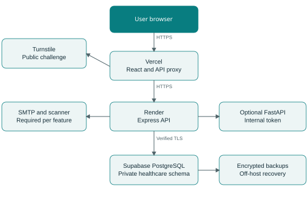
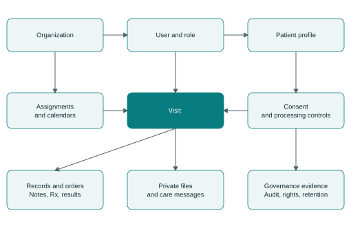

# Medicare technical requirements

MC-TRD-001 | Version 1.0 | 16 November 2026

Status: For stakeholder review and baseline approval

## Contents

1. Technical requirements and system context
2. Contents
3. Technology baseline and constraints
4. Conceptual data model
5. Storage classification and lifecycle
6. API contracts and integration boundaries
7. Security requirements and control applicability
8. Security operations files and trust
9. Environments and configuration
10. Quality attributes and measurable acceptance
11. Build release migration and rollback requirements
12. Observability recovery and operational readiness
13. Traceability verification and approval
14. References and baseline control

## Technical requirements and system context

Medicare uses a React browser application, an Express API and a private PostgreSQL application schema. This document defines technology constraints, data responsibilities, runtime environments and verifiable technical requirements for the product baseline.

| Document control | Value |
| --- | --- |
| Document ID | MC-TRD-001 |
| Version and date | 1.0 / 16 November 2026 |
| Review state | For engineering security and operations review |
| Owner | Engineering lead role; individual appointment pending |
| Related documents | MC-PRD-001 and MC-IA-001 |

Editable source: [Mermaid](../diagrams/10-system-architecture.mmd)

The diagram describes boundaries, not an assurance that every optional service is provisioned. Durable hosted file ciphertext is held in PostgreSQL, not the ephemeral Render filesystem. The browser never connects directly to the application database.

## Contents

Use these sections for review and maintenance. PDF bookmarks provide the same section navigation. Requirement IDs and flow IDs remain stable when page numbers change.

| Section | Page |
| --- | --- |
| Technical requirements and system context | 1 |
| Technology baseline and constraints | 3 |
| Conceptual data model | 4 |
| Storage classification and lifecycle | 5 |
| API contracts and integration boundaries | 6 |
| Security requirements and control applicability | 7 |
| Security operations files and trust | 8 |
| Environments and configuration | 9 |
| Quality attributes and measurable acceptance | 10 |
| Build release migration and rollback requirements | 11 |
| Observability recovery and operational readiness | 12 |
| Traceability verification and approval | 13 |
| References and baseline control | 14 |

## Technology baseline and constraints

| Layer | Baseline | Constraint and rationale |
| --- | --- | --- |
| Web | React 19; React Router 7; Vite 8; Tailwind CSS 3; shared theme tokens | Preserve existing light/dark theme and routed workflows. Tailwind 4 requires a separate PostCSS/theme migration. |
| API | Node.js 24; Express 4; pg PostgreSQL driver | Application engines require >=24 <25. Node 26 and Express 5 are separate migrations, not assumed compatible upgrades. |
| Identity | bcrypt; JWT access and refresh signing; persisted revocable sessions; WebAuthn | Validate origin, relying-party identity and challenge. Separate signing secrets; never expose secrets in a frontend build. |
| Primary data | PostgreSQL; private healthcare schema on hosted Supabase | PostgreSQL 18 is the Compose/CI reference. Confirm actual provider engine and extension compatibility during environment acceptance. |
| Files and evidence | AES-256-GCM; ClamAV; private encrypted upload object store | Scan before persistence; fail closed on scanner error. Retain encryption context and original recovery keys. |
| Optional intake | Python 3.11/3.12 tested; FastAPI; Pydantic; Groq adapter | Disabled by default. Python 3.15 image is deferred pending runtime validation. No diagnostic or urgency guarantee. |
| Optional retrieval | Sentence Transformers; pypdf; SQLite vector index | Curated local corpus; explicit embeddings and cosine retrieval; no claim of a hosted Chroma service. |
| Build and operations | GitHub Actions; Docker/Compose; nginx; Prometheus/Grafana configuration | Locked installations, tests, dependency audits and container checks. Monitoring configuration is distinct from verified alert delivery. |

### Dependency baseline

Main release 029ab9b includes the tested dependency merges completed on 16 November 2026, including WebAuthn browser/server 14 and current reviewed security middleware updates. Local manifests may lag main. Exact resolved versions are defined by main lockfiles, not copied version lists in this document.

Deferred upgrades: PRs 16, 17, 18, 28 and 32. Four later legacy-reference dependency PRs are separate from the original maintenance batch. Legacy sources remain outside active runtime builds.

## Conceptual data model

Editable source: [Mermaid](../diagrams/11-conceptual-data-model.mmd)

The conceptual model groups domain relationships for design review. It is not an executable physical ERD or an exhaustive schema diagram. The supplied catalog CSV is derived from the committed classified inventory; ordered migrations and the database catalog remain authoritative for exact columns, keys and constraints.

| Domain | Representative physical tables |
| --- | --- |
| Identity and organizations | users, roles, sessions, passkey_credentials, organizations, staff_org_mapping, staff_invitations |
| Care and scheduling | patient_profiles, visits, visit_staff_assignments, appointment_calendars, appointment_reservations, medical_records, visit_notes |
| Orders and fulfillment | diagnoses, prescriptions, medication_orders, lab_orders, lab_results, imaging_orders, imaging_reports, radiology_reports |
| Sharing and communication | consents, patient_processing_controls, care_message_threads, care_messages |
| Governance and storage | audit_logs, privacy_rights_requests, privacy_export_receipts, retention_holds, encrypted_upload_objects |

In-progress shared passkey challenges and transcript-based multi-worker AI changes in the local working tree are outside this baseline. Do not infer that those migrations or contracts are deployed.

## Storage classification and lifecycle

| Data class | Storage and handling | Retention and evidence |
| --- | --- | --- |
| Clinical and identity data | Private PostgreSQL schema; authorized API only. Ordinary clinical columns are not all application-encrypted. Government identifier collection requires necessity review. | Apply approved category policies and holds. Provider storage encryption and access evidence are owner obligations. |
| Passwords sessions and passkeys | bcrypt password hashes; revocable session data; passkey public credentials. Browser uses application token management. | Expire or revoke credentials and sessions by policy; never log tokens or private authenticator material. |
| Files and credential documents | Identity-bound authenticated encryption; hosted PostgreSQL ciphertext objects; bounded in-memory validation and scanning. | Patient and file reference must match authorized context. Unreferenced objects and failures require controlled cleanup. |
| Correspondence and governance narratives | Application-encrypted sensitive messages and review narratives, with attributable histories. | Include applicable owned exports; retain protected evidence and legal holds. |
| Audit and security evidence | Retained audit chain and operational logs with restricted access. Application role cannot mutate retained audit evidence. | Do not promise resistance to a malicious database owner; require off-host evidence, finite logs and owner-controlled recovery. |
| Backups and retrieval index | Separate-key encrypted coordinated backups; private off-host copies. Optional local SQLite reference vectors are rebuildable. | Preserve original application and backup keys separately. Approve backup retention and disposal-aware restoration. |

### Storage requirements

TR-DATA-01 The service shall use a restricted runtime database principal, distinct from migration and disposal authority. TR-DATA-02 Protected file retrieval shall verify subject, file reference and authorization before decrypting. TR-DATA-03 Backups shall capture database references and ciphertext consistently and reject unsafe paths or tampering. TR-DATA-04 Retention shall follow approved policies and holds; no universal medical retention period is invented.

Recorded limits: medical report files default to 10 MiB; credential multipart files use 5 MiB per file and at most two files. Hosted durable-object budget has a recorded 64 MiB cap. Confirm current configuration and capacity before enabling real uploads.

## API contracts and integration boundaries

| Interface | Contract and authority | Required verification |
| --- | --- | --- |
| Browser to API | Same-origin /api proxy; mounted /api and /api/v1 compatibility families. Authorization uses server-derived session identity. | Missing/expired credentials and wrong-role/object requests fail without data leakage. Preserve current response compatibility. |
| Authentication | POST /api/auth/login; registration and OTP routes; /auth/passkey options/verify; GET /api/auth/verify; POST /api/auth/logout. | Bot challenge when configured, bounded attempts, replay/expiry rejection, origin/RP checks and session revocation. |
| Appointments and visits | GET availability under /appointments; visit request and state transitions under /visits. | Server validates selected instant and organization; concurrent reservation returns 201/409 as appropriate. |
| Clinical files | GET /api/files/:patientId/:fileType/:fileName after authenticated object scope and reference checks. | No static public upload mount; safe path; no plaintext release without required audit evidence. |
| Rights and consent | Consent grant/update/revoke; privacy request/export/receipt-confirmation and officer review routes. | Owned request/receipt links; purpose controls; evidence-backed completion and reasoned retention outcomes. |
| Internal AI | Optional bearer-authenticated FastAPI calls through the API; provider secret stays server-side. | Bounded payload, timeout and output schema; no clinical success on provider failure. Current committed service uses one worker with in-memory session state. |
| Readiness and telemetry | Public /health and /readyz with minimal status. Production /metrics requires a dedicated token and is not publicly proxied. | Readiness checks database and migration consistency; health is not proof of all integrations. No patient information in status output. |

### Validation and failure contract

TR-API-01 Validate allowed fields, identifier shape, lengths, states and ownership on the server. Use parameterized values and bounded allowlists for SQL identifiers. TR-API-02 Return explicit 400 validation, 401 unauthenticated, 403/404 scoped denial, 409 conflict, 429 throttling and 503 unavailable states as appropriate. Preserve domain-specific contracts; do not expose stacks, query text or secrets.

A complete OpenAPI specification is not claimed. The modules and tests define the present contract. A versioned OpenAPI inventory is a proposed follow-up before third-party API integration.

## Security requirements and control applicability

All 17 reviewed principles have a defined applicability decision. Some are architectural requirements or operating prerequisites rather than switches that can be marked complete once. This table is not a new penetration-test result.

| Control | Requirement and baseline boundary |
| --- | --- |
| TR-SEC-01 Row isolation | Private schema and restricted runtime grants protect the database boundary. Enforce patient/organization/purpose scope in API queries. Do not claim blanket per-user database RLS where the server uses a shared principal. Reassess RLS before any direct Data API access. |
| TR-SEC-02 Route authentication | Authenticate every protected route. Explicit public endpoints include login/registration/OTP, notices, minimal health/readiness, bounded telemetry and public aggregate statistics; each needs its own validation and abuse policy. |
| TR-SEC-03 Trust boundary | Never accept a client role, tenant, patient association, consent or workflow status as authority. Derive it and validate current state server-side. |
| TR-SEC-04 Abuse resistance | Apply general and sensitive-operation rate limits and configured bot verification. Current in-memory limits and token replay state require shared storage before multi-instance deployment. |
| TR-SEC-05 Input and queries | Validate and normalize by field; escape according to output context. Use parameterized query values. Do not treat generic sanitization as a substitute for authorization or SQL binding. |
| TR-SEC-06 CORS and HTTPS | Allow only reviewed frontend origins. Enforce edge HTTPS and HSTS; use certificate-verified database TLS and secure SMTP. CORS does not authenticate non-browser clients. |
| TR-SEC-07 Object access | Every list, detail, file, export and state transition verifies object scope, including opaque UUID routes. Test wrong-patient and cross-organization requests. |
| TR-SEC-08 Bot challenge | Verify public-form Turnstile tokens server-side with configured hostname/action, expiry and replay handling. Public sign-in and registration must recover when a token is consumed. |

Security verification reference: OWASP ASVS 5.0.0. A scoped ASVS assessment with versioned control IDs and evidence is required before claiming a verification level; this document does not claim one.

## Security operations files and trust

| Control | Requirement and baseline boundary |
| --- | --- |
| TR-SEC-09 Admin evidence | Log privileged changes with actor, action, target, result and time. Restrict narrative access; protected evidence failures must not be reported as successful protected mutations. |
| TR-SEC-10 Private storage | Keep application objects and backups private. Hosted ciphertext uses private database storage, not a public media bucket. Any future object bucket requires private access and scoped download authorization. |
| TR-SEC-11 Admin access | Apply protected frontend routes and server authorization. Hiding a menu entry or guessing-resistant URL is insufficient. Preserve organization boundaries. |
| TR-SEC-12 Dependencies | Use lockfiles, audits, source compatibility review, meaningful tests and reviewed container builds. Major runtime/framework migrations require dedicated acceptance. |
| TR-SEC-13 Upload validation | Validate extension, declared MIME, actual byte structure, size and safe identifier; scan before encryption/persistence. Scanner failure blocks uploads. Never trust an uploaded filename as a filesystem path. |
| TR-SEC-14 Browser headers | Retain CSP, frame restrictions, nosniff, referrer policy, permissions policy and HSTS on served application responses. Test required Turnstile, passkey and QR functionality under actual policy. |
| TR-SEC-15 Webhooks | No application inbound webhook consumer is identified in this baseline. Before adding one, require provider-specific raw-body signature verification, timestamp tolerance, replay handling and idempotent processing. Hosting git deployment integrations are provider-managed, not application webhook routes. |

### Secrets and credentials

Signing, encryption, database, SMTP, internal-AI, challenge-verification, metrics and backup credentials stay in environment secret stores. A public Turnstile site key is not a secret; its verification secret is server-only. Key rotation must preserve ability to decrypt retained objects and backups. Frontend configuration is public build output.

### Scope limits

The committed browser token manager uses localStorage; do not claim HttpOnly cookie protection or browser-session-only persistence. Existing passkey challenges and AI memory are process-local in the committed baseline. A shared challenge migration and AI continuation redesign are in-progress local work, not accepted operating controls. Independent threat review and intended-host security testing remain release requirements.

Cross-reference to the original checklist: TR-SEC-01 covers item 1; 02 item 2; 03 item 3; 04 item 4; 05 items 5-6; 06 items 7-8; 07 item 9; 08 item 10; 09-15 items 11-17 respectively.

## Environments and configuration

| Environment | Required configuration and data | Exit gate |
| --- | --- | --- |
| Local development | Node 24; local frontend 3000 and API 5000; PostgreSQL on configured loopback port, commonly 55432. Docker can supply Mailpit and ClamAV. Use synthetic data and unique local secrets. | Install locked dependencies, apply ordered migrations, check /readyz, then exercise selected workflows. |
| Automated CI | Isolated disposable PostgreSQL and explicit test database flags; frontend unit/lint/build; backend unit/integration; Python 3.11/3.12; audits and container checks. | All applicable jobs pass on the candidate and final main revision. Never point destructive tests at working or hosted data. |
| Preview | Vercel branch previews where configured. Preview frontend does not establish an isolated backend/database. | Before authenticated preview use, explicitly bind a synthetic environment, allowed origins and WebAuthn identity. No production patient data. |
| Staging target | A dedicated staging API, database, mail sink and scanner are proposed. No separately verified staging environment is asserted. | Representative migrations, end-to-end roles, integrations, performance and recovery checks. |
| Hosted demonstration | Vercel frontend; Render API; private Supabase schema. Automatic deployment from main. Free-tier sleep and quota limits apply. | Health/readiness, live public smoke checks and required service evidence; retain synthetic-only boundary. |
| Real-use production target | Dedicated reviewed resources, approved agreements/policies, operating scanner/mail/alerts, key custody, recovery and workforce controls. | Accountable owner acceptance of clinical, security, accessibility, data protection and service evidence. |

### Configuration contract

TR-ENV-01 Maintain environment-specific DB_* TLS settings, independent JWT secrets and ENCRYPTION_KEY; FRONTEND_URL/CORS_ORIGIN; WEBAUTHN_ORIGIN/RP_ID; SMTP; upload/scanner settings; TURNSTILE_ENABLED/site/secret; optional AI settings; metrics and separate backup keys. Never copy secret values into documentation. TR-ENV-02 Frontend REACT_APP_* settings are build-time public values; a backend configuration change and a frontend build change are different release operations.

Hosted frontend: https://medicare-vtg.vercel.app. Hosted API: https://medicare-secure-api.onrender.com. The Vercel same-origin proxy uses /api and /readyz; it must not become a public proxy for private metrics or internal AI.

## Quality attributes and measurable acceptance

The following numerical service and usability objectives are proposed targets for a reviewed real-use pilot. They are not measurements, guarantees, or evidence that free-tier hosting can meet them.

| Requirement | Proposed target or invariant | Verification method |
| --- | --- | --- |
| TR-NFR-01 Accessibility | WCAG 2.2 AA on complete priority flows, light/dark theme and supported responsive layouts. | Automated checks plus keyboard, screen-reader, zoom/reflow, error and authentication review. |
| TR-NFR-02 Browser performance | At 75th percentile on agreed mobile profile: LCP <=2.5 s, INP <=200 ms, CLS <=0.1. | Define device/network and sample window; field data and repeatable synthetic tests. No PHI telemetry. |
| TR-NFR-03 API performance | For warmed normal read/write endpoints: p95 <=1 s at 50 concurrent synthetic users over 15 minutes; exports/files/AI measured separately. | Load test with representative dataset; record errors, DB load and audit overhead. Rebaseline by pilot capacity. |
| TR-NFR-04 Availability | 99.5% monthly availability for agreed core endpoints before a real-use commitment. Planned maintenance and dependency scope must be defined. | External probes and incident accounting; free-host cold starts do not establish this target. |
| TR-NFR-05 Recovery | Proposed RPO <=24 h and RTO <=4 h, subject to owner approval and criticality review. | Timed off-host restore plus application decryption, audit verification and promotion rehearsal. Backup success alone is insufficient. |
| TR-NFR-06 Integrity | No double booking, duplicate fulfillment or incorrect-patient persistence in defined concurrency scenarios. | Database constraints/transactions and parallel request regressions. |
| TR-NFR-07 Failure safety | Required audit, scanner and dependency failures return explicit failure; no false success or unprotected file persistence. | Fault injection and orphan/reference reconciliation. |

### Compatibility and capacity

TR-NFR-08 Test current supported Chrome, Edge, Firefox and Safari versions with keyboard and touch where applicable. WebAuthn and QR capture depend on secure context and device permissions. TR-NFR-09 Establish storage, DB connection, backup-size and email limits before scaling; the recorded object cap and free-host limits are demonstration capacity constraints, not a hospital capacity plan.

Metric thresholds are project proposals. The WCAG reference defines accessibility criteria; it does not certify this installation. No universal percentage test-coverage threshold is substituted for meaningful risk coverage.

## Build release migration and rollback requirements

### Reproducible verification

- TR-REL-01 Use reviewed lockfiles and npm ci for frontend/backend; pinned reviewed Python requirements; supported runtime versions and production container builds.
- TR-REL-02 Run frontend lint, theme/font checks, behavior tests and production build. Run backend syntax, unit and actual disposable-database integration tests for domain/data changes. Run Python offline tests, pip check and relevant dependency audits when AI dependencies change.
- TR-REL-03 Inspect release notes and actual API usage before major library upgrades. Rebase or refresh lockfiles against the integration branch and verify final combined main CI. Remove merged head branches; preserve unresolved migrations and active work.

### Database and release sequencing

TR-REL-04 Apply checksum-tracked ordered migrations with a separately privileged principal. Never edit an applied migration or silently run hosted migrations during ordinary API startup. Startup readiness checks schema consistency. Review imported appointment timestamps and reference compatibility before real-data upgrades.

TR-REL-05 Record candidate commit, migration set, configuration changes, integration evidence and rollback boundary. Deploy database-compatible API and frontend in a reviewed order. Optional AI API-contract changes require coordinated deployment. Secrets remain in the deployment stores.

### Rollback and recovery

TR-REL-06 Reverting a frontend or API deployment does not reverse data transformations. Confirm previous code compatibility before rollback. If migration reversal would lose data, restore into a fresh isolated target and use a reviewed promotion plan. Preserve original ciphertext, database backup and both required keys.

### Release verification

Check final CI, deployed revision and /readyz; test public navigation and selected role flows using synthetic accounts. Distinguish cached browser asset mismatch during deployment from a reproducible new-release error. Preserve form state where practical and provide a safe reload/retry state when code assets have changed.

Recorded release evidence from the preceding maintenance task: final main frontend and backend CI passed; Render and Vercel were observed on 029ab9b; readiness returned success and public account navigation loaded. These observations are historical task evidence, not a new acceptance test run performed to create these documents.

## Observability recovery and operational readiness

### Observability contract

TR-OPS-01 Collect minimal route-based latency, request failures, denied access, auth failures, audit failures and service availability. Restrict metrics with a dedicated token. Keep clinical contents, credentials and government identifiers out of telemetry; review existing auth logs for unnecessary identifiers before real use. Use correlation identifiers for diagnosis without embedding records.

TR-OPS-02 Keep log and metric retention finite. The source overlay includes authenticated Prometheus scraping and eight application alert rules. Supply a reviewed real receiver and demonstrate an alert and recovery receipt. A stored notification or valid rule file is not proof of external delivery.

### Backup and recovery contract

TR-OPS-03 Coordinate database rows, file references and durable encrypted objects under one snapshot. Authenticated archives have a separate encryption key, validated manifest and checksums. Restore only into a fresh disposable target during drills; reject overwriting existing databases, path traversal, wrong keys, truncation and inconsistent references.

TR-OPS-04 Preserve application and archive keys independently and outside the archive. Record backup artifact, source revision, migration set, verification, recovery duration and retained outcome. Apply an approved retention schedule and reconcile completed disposal decisions before a restored installation can be promoted.

| Operating prerequisite | Required evidence before real use | Owner |
| --- | --- | --- |
| Malware scanner | Clean file succeeds; malicious fixture rejects; outage fails closed; signatures maintained. | Application operations |
| SMTP and onboarding | Verification and invitation received; expiry/replay and delivery-failure behavior confirmed. | Application operations |
| External alerts | Test and recovery notifications received by the actual incident owner. | Service owner |
| Recovery and key custody | Timed restore, decryption, integrity checks and reviewed promotion exercise. | Recovery and security owners |
| Provider and data governance | Storage encryption/location, agreements, reviewed notices/retention/identifier necessity and workforce access review. | Organization and privacy owners |

The source records daily coordinated B2 backups and successful prior recovery drills. Their existence does not establish continuous current schedule health, a provider guarantee or the proposed recovery objectives. Verify intended-environment evidence at release time.

## Traceability verification and approval

| Product requirements | IA flows | Technical controls and minimum proof |
| --- | --- | --- |
| FR-01 to FR-03 | UF-01; role route inventory | SEC-01 to SEC-08; API auth/object denial, challenge/OTP expiry, passkey validation, revoked session tests. |
| FR-04 FR-05 FR-08 | UF-04 UF-05 | DATA-01/02; NFR-06/07; wrong-patient asynchronous result, correction provenance and audit failure tests. |
| FR-06 FR-07 | UF-02 | API-01/02; NFR-06; reservation concurrency, clinic boundaries, time zones, cancellation and atomic reassignment. |
| FR-09 FR-10 | UF-04 | SEC-07/10/13; DATA-02; scan/tamper/wrong-file denial, order cancellation and concurrent fulfillment tests. |
| FR-11 FR-12 | UF-03 UF-06 | SEC-03/07/09; current scope, revoke/expiry, wrong purpose, emergency read-only and evidence tests. |
| FR-13 FR-14 FR-15 | UF-05 UF-06 | DATA-03/04; OPS-03/04; ownership, receipts, holds, review evidence, disposal and restored-state reconciliation. |
| FR-16 FR-17 | Operations inventory | SEC-02/03/07/09/11; cross-organization admin denial, research threshold and purpose-limited insurance tests. |
| FR-18 FR-19 | UF-01 UF-04; UX contract | API integration gates and NFR-01/02/08; offline provider tests, accessible complete flows and theme compatibility. |

### Evidence record format

For each acceptance result retain requirement ID, candidate revision, environment, preconditions, test data class, expected and actual result, artifact location, reviewer and date. Distinguish implemented source, automated test, live synthetic observation and owner/provider assertion. A skipped test is not a successful result.

### Open decisions and approval

Approve intended organizations/jurisdiction, approved identifier fields, data retention, service tier/capacity, availability and recovery targets, secret custody, integration owners and optional AI/research scope. Engineering accepts architecture and migrations; security accepts scoped control evidence; clinical and privacy owners accept workflow/data use; operations accepts recovery and support. Product accepts the integrated baseline.

### Source maintenance

Update this document with PRD and IA whenever trust boundaries, storage, role gates, APIs, integration contracts or operating environments change. Exact route gates and catalog metadata are included as editable CSV. Diagrams have SVG and Mermaid source files; they must evolve with the implementation.

## References and baseline control

The documents describe the product baseline and proposed acceptance requirements. Material marked Proposed is a target or decision awaiting approval. Conditional capabilities depend on explicitly operated integrations. Source implementation does not by itself establish organizational, provider or regulatory assurance.

### Implementation baseline

Committed source inspection: b8e5761f45b2f50043b84f041073cc6ad9cce2f0. Recorded deployed main release after dependency maintenance: 029ab9b61203bf3b58dcad2d06067c4f33503812. No uncommitted local code is treated as deployed. Exact dependency resolutions belong to the released lockfiles. The source manifest links immutable inspected files, release evidence and the relevant merged pull requests.

### Engineering and design sources

Product scope and coverage: S-01 to S-03. Trust boundaries and data governance: S-04 and S-08 to S-13. Route and API architecture: S-05 and S-06. Scheduling: S-07. Deployment and optional integration: S-14 to S-18. Theme and interaction consistency: S-19. Full paths and immutable repository links are in sources/source-manifest.md.

### External references

STD-01 ISO/IEC/IEEE 29148:2018. Public catalog scope consulted for requirements life-cycle and information-item structure. Full paid standard was not assessed. https://www.iso.org/standard/72089.html

STD-02 W3C WCAG 2.2. Accessibility acceptance target AA; conformance requires complete-flow evaluation. https://www.w3.org/TR/WCAG22/

STD-03 OWASP ASVS 5.0.0. Security verification reference; no complete ASVS level assessment is asserted. https://owasp.org/www-project-application-security-verification-standard/

### Interpretation and approval

These references guide requirements quality, accessibility acceptance and security verification. A PRD, information architecture document and technical requirements specification do not have one universal mandated format. The package provides stable identifiers, explicit scope, measurable criteria, traceability, source evidence, risks and review ownership. It does not assert ISO certification, WCAG conformance, an ASVS level or medical/legal certification.

Public standards pages were consulted in the user Chrome browser on 16 November 2026. No external credentials, patient records or private environment values are included in this package.
